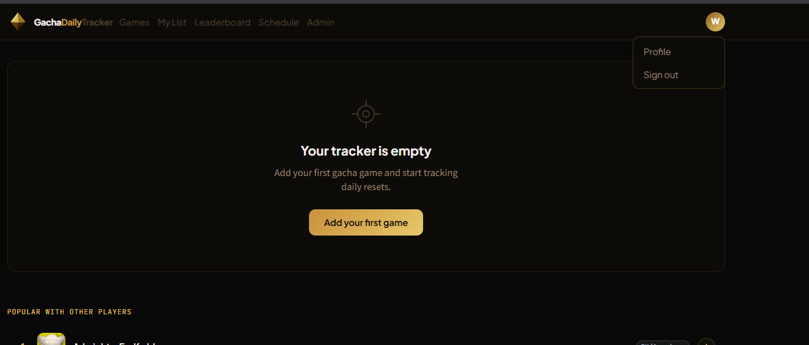

# GDT V5: Release Notes & Plan

V5 isn't one big drop. It ships as a series of chunks merged to `main` over time. This file tracks what's already in V5, what's still planned, and in what order. When V5 is called done, section 1 becomes the V5 entry in the README version history.

Last V4 commit: `30ee1c5` (2026-05-22). Everything after that counts as V5.

---

## 1. Shipped in V5 so far ✅

**Streaks & badges**
- ✅ Streak achievement badges on `/profile`, real CSS 3D polyhedra from Iron (7 days) to Diamond (365 days), no WebGL (`6d3b9f2`)
- ✅ Permanent `users.streak_best` that never resets, so badges survive a broken streak (`6d3b9f2`)
- ✅ End-to-end badge milestone test (`npm run test:streak-trigger`), badge preview moved behind admin (`7ca8d22`)
- ✅ Current streak counter with progress to the next badge (`a308549`)
- ✅ Gacha-pull reveal overlay when a new badge unlocks, tunable on `/admin/reveal` (see Pillar 2)

**Homepage**
- ✅ Status-first homepage for signed-in users (`87eb08d`)

**Admin**
- ✅ Statistics/analytics panel: KPIs, signup/completion trends (7d to all-time), top streaks, most-tracked games, region and country breakdowns, every chart has a table view (`977baaf`)
- ✅ Sortable Users/Submissions tables, real pagination, emails masked server-side (`a925fd9`)
- ✅ Kintsugi background generator at `/admin/kintsugi`: seeded, islands grown by sequential cracking, SVG export (`d7dfdcc`, `2467027`)

**Game data**
- ✅ Safe upstream sync: never deletes games, renames in place via `data/game-renames.json`, dry run preview, refuses if upstream looks truncated, never deactivates a game someone tracks (`c0f1227`)
- ✅ Sync planner unit tests plus Postman/CI coverage (`ffa6915`)

**Profile**
- ✅ Timezone selector and IANA timezone validation fix (`333c386`)

**Design**
- ✅ Custom on-brand 404 page, "This banner has already ended." (`b51286f`)
- ✅ Kintsugi card hover veins fixed (pointed at a missing SVG before), toned down and turned off on admin/profile cards (`c61dc48`, `6dcb402`)

**Reliability & ops**
- ✅ Release-phase schema check: Heroku refuses a deploy if the live DB is missing a table or column from `01-schema.sql` (`f565b51`)
- ✅ Daily scheduled Heroku backups plus `npm run backup:pull` for local copies (`f565b51`)
- ✅ Stopped logging the full `DATABASE_URL` on connection errors (`746eb4b`)
- ✅ Clearer error for Brave's disabled push service, spam-folder note on the reset email (`6f1ffa3`)

**Accounts & security**
- ✅ Email verification with OTP codes, fake-domain blocking, 7-day cleanup of unverified signups, and verified-only admin/submissions/scheduler/digest/badges (see Pillar 1)
- ✅ Closed the `/gdt/update/*` hole that let any logged-in user edit or delete games

---

## 2. Pillar 1: Email verification ✅

Started when someone registered with `nogid52036@dosbee.com`, a known disposable domain. Built in October 2026.

**Signup and verification**
- ✅ 6-digit code emailed through Resend at signup. The register page switches to a code screen ("Skip for now" allowed), and `/verify-email` handles it later.
- ✅ Codes are hashed (HMAC with the pepper), expire in 10 minutes, die after 5 wrong tries, and can be resent once every 60 seconds.
- ✅ Changing your email resets verification and sends a code to the new address.
- ✅ Existing accounts were grandfathered as verified by the migration.
- ✅ Without `RESEND_API_KEY` (local Docker), the code is printed in the backend log instead.

**Stopping fake addresses**
- ✅ MX check at signup and email change: domains that don't exist, have no mail server, or have broken mail DNS (like a parked `nut.com`) are refused before an account is created. Temp-mail services with real mail servers still pass; verification is the gate for those. `SKIP_EMAIL_DOMAIN_CHECK=true` turns it off in CI.
- ✅ New signups that don't verify within 7 days are auto-deleted by an hourly job (`users.email_verify_deadline`). Never applies to grandfathered accounts, admins, or existing users who changed their email.

**What unverified accounts can't do**
- ✅ Admin tools: every admin route refuses, and the admin area shows a lock screen. An unverified user can't be promoted to Admin/Owner.
- ✅ Game submissions and the play scheduler.
- ✅ Daily email digest (can't be turned on, and the cron skips them).
- ✅ Streak badges stay locked. Streaks still count, and earned badges unlock the moment they verify.

**UI**
- ✅ Banner under the navbar with the deletion date, and a "limited banner" countdown card on `/profile` (days/hrs/min/sec, red in the last 24 hours).

**Security fix found along the way:** `/gdt/update/*` (edit, add, delete games) only checked for a login, so any account could change the catalog. It now requires a verified admin.

**Email setup follow-ups (DNS, no code)**
- Add a DMARC record (Cloudflare → Email → DMARC Management, or TXT `_dmarc` = `v=DMARC1; p=none;`), move to `p=quarantine` after a couple of clean weeks.
- Replace `noreply@` with a real address (`hello@`) through Cloudflare Email Routing and `RESEND_FROM_EMAIL` on Heroku.
- Optional later: send from a subdomain (`mail.gachadailytracker.com`) to isolate reputation.

---

## 3. Pillar 2: Streak badge unlock reveal ✅

Badges used to unlock silently: `POST /tracker/streak` returned `streakBest` and nothing read it, so a new badge only showed up on `/profile`. Built in October 2026.

**The reveal**
- ✅ Plays right away when the last game of the day crosses a badge threshold. The screen dims, a light streak shoots in, a flash and shockwave, slowly turning rays, then the `PolyhedronBadge` whirls in with the tier name and "N-day streak". Confetti in the tier's colors.
- ✅ One light streak per face of the tier's shape (Iron 4, Bronze 6, Silver 8, Gold 12, Platinum 20), read from the badge geometry. Diamond counts its star's 60 visible triangles. Gold and up also get a second ray layer and side confetti, and Diamond a second flash.
- ✅ First click (or Esc/Space/Enter) skips to the final card, the next one closes it. There's also an X button. Reduced motion skips the effects and just fades the card in.
- ✅ `/admin/reveal` preview: pick a tier and streak days, slow it down to 0.25×, force reduced motion, auto-loop. The timings are the `rv-*` block in `globals.css`.

**How it's triggered**
- ✅ The API returns `tierUnlocked` (tier key or null), decided server-side from the old and new `streak_best` in one statement, so it's only set on the call that crosses the threshold.
- ✅ Dashboard and home call the shared `BadgeRevealProvider`, with a localStorage backstop (`gdt_badge_revealed`) so the same tier never replays on that browser.
- ✅ Anon users don't get badges, so no reveal. Unverified accounts get `tierUnlocked: null`, and the reveal plays when they verify instead (highest tier they've earned).
- ✅ `npm run test:streak-trigger` asserts `tierUnlocked` for every tier, null on a repeat check, and null for an unverified user.

---

## 4. Pillar 3: Game submissions revamp + review the pending games

Comes before weekly resets. 16 user-submitted games were sitting in `game_submissions` unreviewed, and the admin page needed work before reviewing them made sense. Built in October 2026.

**What "Approve" used to do:** mark the submission approved and insert the game as inactive with no icon. A game with the same name and server silently did nothing, and the admin had to find it on `/admin/games` to activate it. No way to fix typos, no icon, no preview.

**Review panel** ✅ ("Review" on `/admin/submissions`)
- ✅ Edit name, server, timezone and daily reset before approving; the submitted value shows under any field you changed. Server field suggests existing spellings.
- ✅ Similar games already in the catalog, as you type (name scoring in `src/services/similarGames.ts`, no Postgres extension). An exact name + server match is flagged and blocks approving.
- ✅ Icon upload with Crop/Pad, previewed through the real server pipeline, plus a live `GameCard` and `DashboardCard` with the edited data.
- ✅ "Approve & activate" or "Approve as inactive". One transaction creates the game, saves the icon and links the submission (`game_submissions.game_id`). A duplicate is now a 409 that names the existing game.

**Custom icons** ✅
- ✅ Stored in Postgres (`game_icons`, BYTEA), since the Heroku disk is wiped on restart. Served at `/gdt/icons/custom/<id>-<hash>.webp` with an immutable cache; the hash changes when the icon does.
- ✅ `games.icon_name = 'custom/<id>-<hash>'`, and one `gameIconSrc()` helper replaced the five copy-pasted icon URLs, so no game query had to change.
- ✅ Admins only. Type checked from the bytes (PNG, JPEG, WebP, GIF; no SVG), 2 MB cap, re-encoded with `sharp` to a 96×96 WebP, which strips metadata and anything hidden in the file. Animated GIFs stay animated.
- ✅ Upstream sync never replaces a custom icon.
- ✅ The old `/admin/games/:id/icon` wrote GIFs to the dyno disk, which never reached users. It now uses the same pipeline, so "Icon" on `/admin/games` works for any game.
- ✅ `npm run icon:process` runs the same pipeline on a file or folder.

**Reset times and servers, made clear** ✅ (came out of the first look at the 16, where "Asia/Manila 15:00" and "Europe/Moscow 23:00" were hard to compare with the catalog)
- A reset is one moment, the same everywhere; `(timezone, daily_reset)` is just how it's written. A Global server still has one reset for everyone. The timezone only matters for DST, and the IANA zone handles that, so no DST question on the form.
- ✅ Submit form defaults to the submitter's own timezone (was LA), shows a live "= 07:00 UTC · 12:00 AM your time" line to check against the in-game timer, and warns "Already tracked" while typing the name.
- ✅ Server is a dropdown of 13 regions with plain labels ("Americas (North + South share one server)" vs "North America (US / Canada)"), stored as the catalog's existing values. "Other…" allows a short name (2–30 safe characters) and requires notes. The API enforces it (`src/constants/serverRegions.ts`), so "nutballsserver" or "Nutaku" is a 400.
- ✅ Review panel shows every reset in UTC, marks similar games "same reset" / "1h later", and has "Same moment on:" buttons that rewrite the time onto UTC or a sibling server's clock. Server field is the same region list plus existing catalog spellings, with free text as a last resort.

**Tests:** `npm run test:icons` (unit, in CI) and `npm run test:submission-review` (e2e against the local backend, also covers the server rules).

**Review of the 16** ✅ (Oct 2026, oldest first, each checked against sources). 13 handled, 3 adult ones left pending (see NSFW below).
- Approved: PGR Asia-Pacific (#3235, inactive), XXL WOOFIA, DMC: Peak of Combat Americas, Evitania Online, Aniimo EU, Lord of Mysteries CN (inactive, 08:00 Beijing unverified), Company of Heroes 3 (`Etc/UTC 00:00`, from the 1.1.0 patch notes: daily challenges at 12:00 am GMT), Neverness to Everness CN, Azur Promilia CN (inactive, beta reset time).
- Rejected: Hololive Dreams, CookieRun: Crumble, Limbus Company (all already tracked at the same reset), Legend of Phoenix (couldn't identify it).
- Left over: rename #3235 to "Punishing: Gray Raven" and activate it. Activate Lord of Mysteries CN and Azur Promilia CN once their reset times are confirmed.

**Not merged yet, ships with the next pillar's PR.** These are on `dev` after the Pillar 3 merge. None needs a migration:
- `589687c` Add/Edit Game uses the region, timezone and reset pickers; the API validates the timezone and reset time, and a rename clash is a 409.
- `e5646b7` Reviewed submissions show who approved or rejected them ("Approved by <username>").
- `fd6b314` Icon upload with a live preview inside Add/Edit Game, icon thumbnails on the game rows, separate Icon button removed.
- Small fix still to do: the "game #id" link on a reviewed submission opens `/admin/games` but doesn't search for that game (the page ignores `?search=`).

**NSFW / adult gacha games.** Put off for now (Booty Calls, Poker n' Sluts and Black Myth: Westward Journey, all "Nutaku", stay pending). Revisit when more come in. The catalog already has some from upstream (e.g. Action Taimanin). Leaning toward a small, discreet 18+ marker on game-list cards, or nothing at all, rather than anything that draws attention. Earlier options:
- (a) Allow with a `content_rating` flag. Hidden from browse and popular lists by default, opt-in toggle (profile for accounts, localStorage for anon), icon blurred until opted in.
- (b) Allow only if the game is on a mainstream store (Google Play, App Store, Steam) and use that store's rating as the line.
- (c) Reject explicit-only titles.

The ToS and privacy policy may need a line either way.

---

## 5. Pillar 4: Weekly resets

From a closed GitHub issue: WuWa has a mode that gives 160 Astrite and resets weekly, HSR has a similar weekly mode for pull currency. When asked, the idea was a weekly checkbox that resets once a week next to the daily one (not a weekly history view).

**Notes**
- Game-Time-Master has no weekly data, only `dailyReset`, so weekly reset days are admin-curated. Most games reset Monday at their daily reset time. Add `games.weekly_reset_day SMALLINT` (null means no weekly tracking).
- Store completions in a `weekly_completions` table (or a `period_type` column on `daily_completions`), with the period computed in game-local time like the V2.5 daily fix.
- UI: a second checkbox or "weekly" pill on `DashboardCard`, with a countdown to the weekly reset. The admin games page gets a weekly-day field. Submissions could include it later.

**Open questions**
- One weekly box per game, or multiple named weeklies (bosses, shop, mode)?
- Do weeklies count toward the streak?
- Anon support? Probably yes, it's cheap in localStorage.

---

## 6. Smaller V5 items

**Anon browser notifications.** Anon users are deliberately minimal, but notifications are the one thing they really miss. Idea: after an anon user adds their first game, a small settings prompt offers to turn on browser push. The catch is that push is sent by the server per user (`push_subscriptions.user_id`, `src/workers/notificationCron.ts`), so anon push needs either an anon subscription row that carries their game IDs, or a lighter "notify while the tab is open" mode. Clearing site data removes it, same as the rest of anon state.

**Per-page kintsugi backgrounds.** ✅ The generator itself is done. What's left: give login, register, forgot-password, reset-password and 404 their own generated SVGs, since they all share `kintsugi-veins-login-reg.svg` right now. A Web Worker to keep slider drags smooth is optional.

**More Ads for anon users** in the my list page have some ads that suggestion to sign up to save and sync their list where every they go. also in that same page or in the main home screen page or both advertise the schedule tracker. maybe encourage streaks/badges.

**Popular Games: count anon users, weighted.** Right now only accounts move the chart. `/games/popular` ranks by `games.add_count`, which only goes up on the logged-in add routes (`POST /tracker/games/:id` and `/bulk` in `src/routes/tracker/tracker.ts`). Anon adds stay in localStorage, and only reach the chart if that person later registers and their list gets bulk-synced. `add_count` also never goes down: removing a game or deleting an account doesn't subtract, so it's lifetime adds rather than current popularity. With a small user base, a few accounts adding and removing games reshuffled the top 10 a lot within about two months.

**Leader board update** at the moment the leader board is at coming soon the issue is that that i need more users to be consistant with doing thier dailes. so a most 5 or less users are on the board. this is where you can break two leader boards a current streak and a historic best streak so that maybe like 20 users in the past have got a best streak of 1-20 days we have some activty. but we can toggle this in the admin to show both historic best streak and live current streaks. someone could have both spots of live and best like a person with 60 current would also be 60 at the best streak leaderboard.

**Proper Logout on JWT Exprired Sessions** At the moment i think we have a 30 day JWT exprired sessions. but we need to make sure that when a user logs out that the JWT is also removed from the client side. and the front end shows they are logged out. in this screen shot my main JWT toke has expired but im not really logout i have to click on my profle and logout. it looks bugged. but i know the token expired because my game track list is empty.  this should be like the first major thing to fix in this section.

Plan: a weighted score that mixes both groups.
- **Accounts:** rank by how many users track the game right now (`COUNT(*)` from `user_games`) instead of the lifetime `add_count`, so removals and deleted accounts drop out.
- **Anon:** new `games.anon_add_count` column, bumped by a public endpoint (e.g. `POST /games/:id/anon-add`) when an anon user adds a game. One count per game per browser (localStorage flag) and a per-IP rate limit, since anyone can call an endpoint that has no login. Removing the game in the browser could call a matching decrement.
- **Score:** something like `current_trackers + 0.5 × anon_add_count`, with the anon weight stored in `site_settings` so an admin can tune it or set it to 0 if it gets gamed.
- Count each person only once: a registering anon user's bulk sync already counts them as an account, so it shouldn't also keep their anon count. Accept a small overlap or decrement on sync.
- Keep `add_count` for the analytics panel's history.

Open questions: starting weight? Does anon decrement on remove, or count adds only? Show the account/anon breakdown in admin analytics?

**IP geolocation.** Low priority. `getTimezoneFromIP()` in `src/services/timezoneService.ts` is still a stub returning `America/Los_Angeles`. Real users send their browser timezone at signup, so only raw API calls hit it. Free options if it's ever needed: `ipapi.co`, `ip-api.com`, `ipinfo.io`.

---

## 7. Last, for fun: Gacha-chan mascot

Replaces the old "badge mascot per tier" idea. The polyhedra stay as the badge art.

- **Gacha-chan:** the embodiment of the top-tier pull, the gold/SSR/UR character. Kintsugi black and gold, chibi style. Other character ideas are welcome.
- **First use:** a dazed Gacha-chan with swirly (@_@) eyes on the 404 page, as a static SVG so the 404 stays a zero-JS Server Component. Maybe a slow CSS-only spin on the eyes.
- **Later:** she could show up in the badge reveal.
- **Needs concept work first:** silhouette, outfit, gold-crack motifs, a few expressions. Hand-written SVG anime art from Claude is hit or miss, so the likely path is concept art with an image generator, then trace and simplify to SVG.

---

## 8. Dropped

- **Hoyolab API sync.** No official public API, it would need users' Hoyolab auth cookies, and it risks breaking Hoyoverse's ToS. Not doing it.

---

## 9. Open questions

- Custom icon storage: DB or repo?
- NSFW policy for submitted games
- Weekly resets: one box per game or named weeklies?
- Is anon push worth the backend work?
- Popular Games: anon weight, and whether to rank by current trackers
